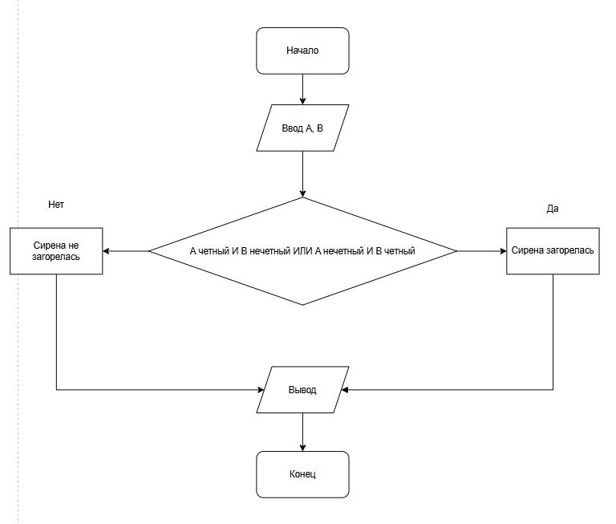

# Домашнее задание к работе 4
____

## Условие задачи
____

Прибор на заводе имеет две контрольные лампы, соответствующие значениям датчиков A и B. Сирена тревоги должна загораться, если ровно одна из ламп показывает нечетное значение. Запишите условие для включения сирены.

## 1. Алгоритм и блок-схема
____

### Алгоритм

1. **Начало**
2. Объявить переменные:
   - `firstIndicator` — переменная, куда попадет первое значение.
   - `secondIndicator` — переменная, куда второе значение.
3. Запросить исходные данные:
   -```c
    puts("Введите целые значения A и B для индикаторов: ");
    scanf("%d %d", &firstIndicator, &secondIndicator);
    ```
5. Инициализировать переменные со значениями ламп:
   - `int firstLamp = firstIndicator;`
   - `int secondLamp = secondIndicator;`
6. Согласно условию, сирена должна загореться тогда, когда только одно значение из двух будет нечетным. Оно будет выглядеть так: `firstLamp % 2 != 0 && secondLamp % 2 == 0 || firstLamp % 2 == 0 && secondLamp % 2 != 0`.
7. Вывести результат, в зависимости от истинности выражения.
8. **Конец**

### Блок-схема


 [Ссылка на блок-схему](https://app.diagrams.net/#G1gbS5uqZz5COACX76xFl9WXr6SDUFxvg3#%7B%22pageId%22%3A%22Rx9zcCg74zxVW4MSbvLp%22%7D)


## 2. Реализация программы

```c
#include <stdio.h>
#include <locale.h>

int checkIndicator();

int main() {

	// Кодировка
	setlocale(LC_ALL, ".UTF-8");

	// Вызов приверки
	checkIndicators();

	return 0;
}

int checkIndicators() {

	int firstIndicator;
	int secondIndicator;

	puts("Введите целые значения A и B для индикаторов: ");
	scanf("%d %d", &firstIndicator, &secondIndicator);

	int firstLamp = firstIndicator;
	int secondLamp = secondIndicator;

	if (firstLamp % 2 != 0 && secondLamp % 2 == 0 || firstLamp % 2 == 0 && secondLamp % 2 != 0)
		puts("Сирена заработала");
	else
		puts("Сирена не сработала");

	return 0;
}

```

## 3. Результаты работы программы

Сирена загорелась
ИЛИ
Сирена не загорелась

## 4. Информация о разработчике

**Терентьев Максим**
**бТИИ-262**
